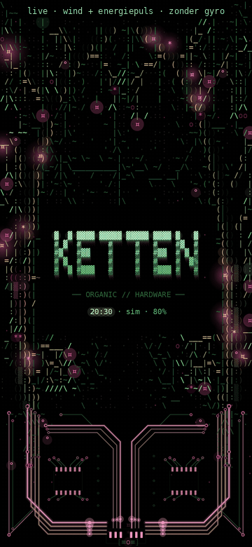

# Ketten Live Wallpaper — Organic Hardware

Een interactieve, 100% native Kotlin **3D ASCII Live Wallpaper** voor Android, ontworpen voor AMOLED-smartphonescreens.

<p align="center">
  
</p>
<p align="center"><sub>Gerenderd met de echte scene-engine (zonder gyro-input): eerst live wind + een energiepuls vanuit de USB-C nexus, daarna een tijdlapse van de groei van 06:30 tot 21:00.</sub></p>

---

## Wat doet het?

- **3D `KETTEN`-logo met diepte-sway** — Een volumetrisch 3D ASCII-logo op sub-pixelniveau dat reageert op het kantelen van je telefoon, het swipen tussen homescreens en aanrakingen (inclusief periodieke lichtglans en tik-schokgolf).
- **Gyroscoop & homescreen-parallax (optioneel)** — De voorgrondranken, verre achtergrondranken en wortels verschuiven in meerdere dieptelagen mee via de zwaartekrachtsensor (`TYPE_GRAVITY`, met terugval op de accelerometer) en homescreen-swipe (`onOffsetsChanged`). De sensor voegt alleen diepte toe: alle animatie loopt op een eigen tijdbasis en werkt identiek zonder gyro.
- **Samenhangende wind** — Eén gedeeld windveld met rollende vlagen stuurt stammen, takken, bladeren en sporen. Een stam beweegt als geheel, een tak zit vast aan de stam en zwiept naar de top toe verder uit, en bladeren kantelen mee met de vlaag (`/` `\`) zodat je de windgolf door het bladerdak ziet trekken. De ritmes zijn bewust gespreid: stam ≈ 0,18 Hz (vergelijkbaar met echte bomen), takken ≈ 0,33 Hz, bladtrilling ≈ 0,7 Hz.
- **PCB-substraat met sporen & via's (onderste kwart)** — Het onderste kwart van het scherm is opgebouwd als een strakke, vector-gerenderde printplaat (volledig wind- en rimpelvast): pixel-exacte 45°-koperbanen, parallelle bussen die overdag in spoorbreedte én aantal banen meegroeien (1 tot 4 parallelle sporen), dual-row SMD IC-footprints met ENIG-pads en silkscreen Pin-1 markering, geboorde through-hole via's met koperring, en ground-stitching via's rondom de centrale USB-C nexus (`[=o=]`). Er groeit hier geen vegetatie: waar de koperbanen de voet van de ranken bereiken gaan ze over in wortels, die van dikke schors naar fijn haarwortel versmallen en in een via op het spoor "inenten". Over de dag worden die wortels dieper en talrijker. Energie- en laadpulsen vertrekken als een heldere vonk uit de USB-C nexus (die op dat moment oplicht), lopen over het koper naar de voet van de ranken en stijgen daarna als gloed met een scherpe kop en uitdovende staart door stam en takken omhoog, met gelijke snelheid in cellen per seconde en licht vertragend richting de toppen.
- **Interactieve touch-effecten** — Tikken of slepen veroorzaakt windrimpelingen door bladeren en ranken, schudt gloeiende sporen los en stuurt bioluminescente energiepulsen omhoog door de stengels (terwijl het substraat onderin strak en stabiel blijft).
- **24-uurs *Spectral Recipe*** — De kleuren verschuiven automatisch met het tijdstip van de dag tussen *Ochtend (480nm)*, *Dag (Full-Spec)*, *Avond (660nm)* en *Nacht (Biolum)* — of kies handmatig een vast spectrum in de app.
- **Oplaad- & batterijvisualisatie** — Zodra de telefoon aan de lader hangt, pulseren er continu energiepulsen vanuit de onderkant de plant in.
- **Rustig midden voor iconen & widgets** — Langs de randen gedetailleerde flora en bloeiende toppen (`· o * ¤`), in het midden ruimte voor je apps en een subtiele regel onder `── ORGANIC // HARDWARE ──` met **tijd · datum · batterij%**.
- **3D cilindrische stammen & dieptelagen** — Hout en blad zijn duidelijk verschillende materialen: stam en takken in lichte, warme schorstinten (afgeleid van het actieve spectrum) met licht van boven (bovenkant belicht, onderkant en onderste bladeren in schaduw), blad in verzadigd groen. Hout is stijf en zwaait rustig mee; blad volgt zijn twijg en fladdert daarnaast op eigen ritme, dus blad beweegt duidelijk meer dan de takken. Voorgrondstammen met cilindrische licht-/schaduwshading, gebogen organische schorsnerven, warm rim-light richting de lampjes en 3 atmosferische dieptelagen (achtergrond als zachte stippeling, middenplan, voorgrond) zodat de voorgrondtakken de leesbare structuur blijven; naar voren hangende delen bewegen sterker mee met de parallax.
- **Organische dagcyclus (06:00–06:00) & hoekvulling** — Begint 's ochtends (`06:00–09:00`) met twee dunne, onvertakte ranken met losse blaadjes, lampjes langs de rank en een eenvoudig mycelium-netwerk. Overdag (`09:00–18:00`) groeien vanuit exact die blaadjes vertakkingen (nieuw hout ontkiemt zichtbaar van wortel naar top als `.` → `:` → teken). De stam verdikt van de voet naar boven; takken worden van de top naar de stam steeds dikker: dun (`|`), een rechtopstaand "is-gelijk" (`║`, als vectorbuis getekend omdat het Android-monospacefont geen box-drawing-tekens heeft) en bij de stam een buis van twee cellen breed; horizontaal `=`. Dik hout is aan beide kanten even licht en lichter naarmate het dikker wordt, zodat het als één massief lichaam naar voren komt; hetzelfde geldt voor de stam zodra die dikker wordt. Het oude hout kruipt met de dag verder naar buiten, dragen blad alleen op het jongere buitendeel, buigen onder hun eigen gewicht door en laten hangende zijtakjes met een eigen bladtrosje en knop naar voren vallen. Per bovenhoek groeien een paar duidelijke hoofdtakken in plaats van een wand van overlappende takken, en het middenplan is daar bewust luchtiger die alle 4 de rechthoekige schermhoeken vullen en de 2e en 3e achtergrondlaag steeds verder verdichten richting de avondpiek (`18:00–23:00`), gevolgd door een vloeiende nachtafbouw (`23:00–06:00`).
- **Harde exclusierand rond het logo** — Rondom het `KETTEN`-logo, de slogan en de statusregel blijft altijd een strakke vrije zone vrij van begroeiing, ook bij wind, aanraking en parallax.
- **Instellingenscherm met live preview** — Direct toegankelijk vanuit de app én via de *Instellingen*-knop in Android's wallpaper-kiezer (`android:settingsActivity`): animatiesnelheid (`0.2x–2.5x`), aantal bloom-lampjes (`0–24`), toggles voor wind/lampjes/groei en een 24-uurs tijd-simulatieslider.
- **AMOLED-vriendelijk** — Puur `#000000` achtergrond, adaptieve FPS (20 FPS rust / 30 FPS actief / 15 FPS batterijbesparing) gekoppeld aan de vsync van het scherm (`Choreographer`, dus ook vloeiend op 90/120 Hz-panelen), bitmap-caching en pixel-shift tegen inbranden.

---

## Hoeveel is er over van de originele MS-DOS-syntax?

Kort antwoord: **qua daadwerkelijke MS-DOS-code of ANSI escape-sequences: 0%** — maar qua **visuele grammatica en tekenbuffer-architectuur leeft zo'n ~15% van het klassieke MS-DOS / ANSI-art-principe nog rechtstreeks door**:

### Wat er wél nog uit de MS-DOS / CP437-traditie komt
- **Het karaktercel-raster (`cols × rows`):** De hele scène (`KettenAsciiScene`) schrijft eerst naar een vast monospace tekenraster (`gridChars` en `gridColors`, vergelijkbaar met een klassieke VGA text-mode buffer van `80×25` cellen, maar dan op `56×76` voor portretschermen).
- **Zuivere ASCII + CP437-tekenset:** Alle ranken, schors, bladeren, mycelium, PCB-sporen en oplichtende toppen worden opgebouwd uit gewone ASCII-tekens (`| / \ _ - ~ : . * o ° ¤ [=o=]`) aangevuld met een handvol klassieke Codepage-437 / box-drawing en shading glyphs (`▒ │ ┃ ─ ·`) in `Typeface.MONOSPACE`.
- **Het 5×32-blokmasker:** Het `KETTEN`-logo gebruikt nog een klassiek 1-bit tekstmasker (`#` en spaties) zoals in vroege DOS-banners en `.NFO`-bestanden.

### Wat er 100% modern Android / Kotlin is (~85%)
- **Geen DOS-runtime of escape-codes:** Er zitten geen `ESC[...m` ANSI-kleurcodes, `0xB800` video-memory writes, BIOS/DOS interrupts (`INT 21h`) of oude `.COM`/`.BAS`/`.PAS`-code in de codebase.
- **Native Android `Canvas`-hybride:** Bovenop het karakterraster draaien moderne graphics en systeemkoppelingen: `Paint` met 24-bit RGB-interpolatie (`SpectralRecipe`), een vector-PCB-substraat (`Path`, SMD-pads en geboorde via's), gecachte 3D-dieptelagen als `Bitmap` met sub-pixel sway, `RadialGradient`-lichtblooms, hardware-zwaartekrachtsensor (`TYPE_GRAVITY`), Bézier-curven en `SharedPreferences`.

Je zou kunnen zeggen: **de syntax is 100% Kotlin/Android, maar het hart is nog steeds een verlichte MS-DOS-tekstbuffer.**

---

## Download & Installatie

1. **Download de APK** vanaf de [Releases-pagina](https://github.com/ketten-dev/nlkettenlivewallpaper/releases/latest) (`ketten-live-wallpaper-v1.5.0.apk`).
2. **Installeer de APK** op je Android-telefoon (sta eenmalig installeren van onbekende apps toe voor je browser of bestandsbeheerder als Android daarom vraagt).
3. **Open `Ketten Live Wallpaper`** vanuit je app-overzicht:
   - Tik en sleep op het scherm om de animatie direct uit te proberen.
   - Kies eventueel een kleurmodus met de knop **Spectrum** of pas de instellingen aan.
   - Tik op **Achtergrond instellen** → kies **Startscherm** (of **Start- en vergrendelscherm**).

*(Minimale Android-versie: Android 15 / API 35+)*

---

## Zelf bouwen vanuit broncode

```bash
git clone https://github.com/ketten-dev/nlkettenlivewallpaper.git
cd nlkettenlivewallpaper
./gradlew :app:assembleDebug
```

De gebouwde APK verschijnt in `app/build/outputs/apk/debug/app-debug.apk`.
